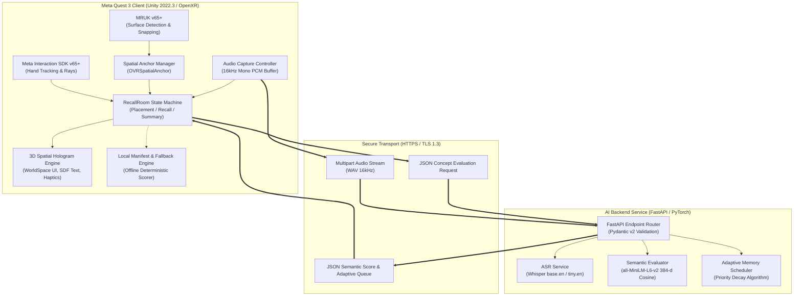
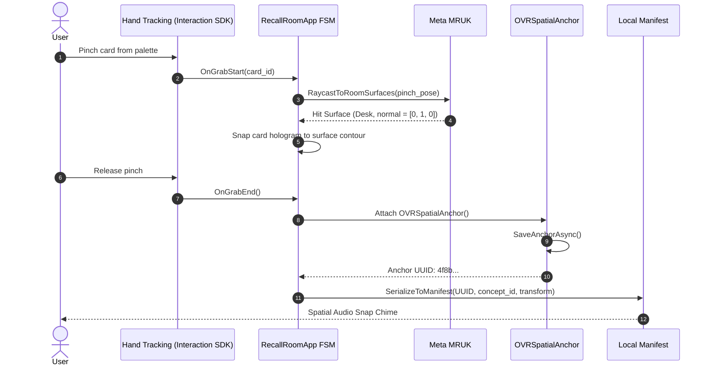
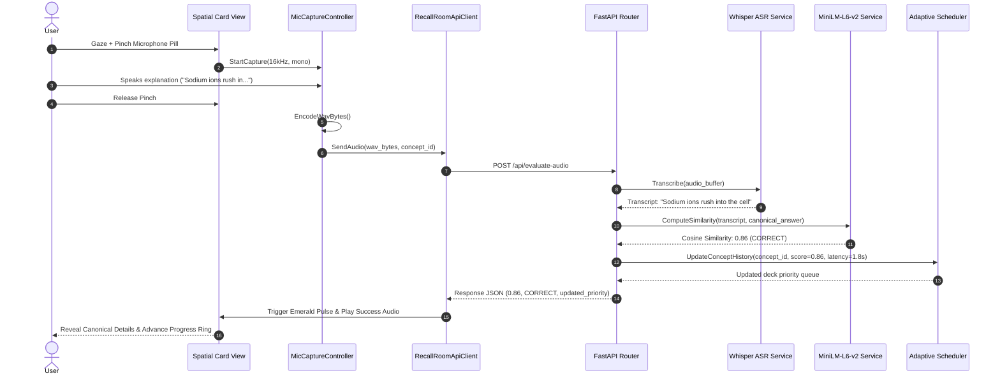

# RecallRoom XR — System Architecture Specification

## 1. System Overview

**RecallRoom XR** is a mixed reality cognitive augmentation platform that operationalizes the **Method of Loci** (memory palace technique) inside physical learning environments. The system consists of two primary tiers:

1. **Standalone Mixed Reality Client (Unity / Meta Quest):** An OpenXR-compliant spatial client built with Unity 2022.3/Unity 6, utilizing the **Meta XR Interaction SDK v65+** and **MRUK (Mixed Reality Utility Kit v65+)** for hand tracking, surface snapping, and persistent local spatial anchors.
2. **AI Inference & Evaluation Backend (Python FastAPI):** A high-throughput, low-latency microservice providing on-premise/edge speech recognition (**OpenAI Whisper**) and deterministic semantic similarity evaluation (**Sentence Transformers `all-MiniLM-L6-v2`**), accompanied by an adaptive memory decay scheduler.

---

## 2. Client-Side Subsystem Architecture

### 2.1 Interaction & Ergonomics Layer
* **Direct Pinch & Ray-Pinch Interactors:** Utilizes Meta Interaction SDK's `HandGrabInteractable` and `RayInteractable`.
* **Ergonomic Constraint Solver:** Automatically adjusts card placement depth. If a user attempts to place a card beyond $0.65\text{ m}$ in free air, the card gently magnetic-clamps to the nearest detected surface or settles within the user's primary reaching sphere ($0.35\text{ m} - 0.60\text{ m}$).
* **Surface Snapping via MRUK:** Raycasts from hand pinch poses intersect with the physical room's mesh/planes (desks, walls, tables) generated by Meta's Mixed Reality Utility Kit. The card aligns its normal to the physical surface normal ($\vec{n}_{\text{surface}}$).

### 2.2 Spatial Anchor Lifecycle Management
* Each placed concept card is backed by a native `OVRSpatialAnchor`.
* When a card is released onto a surface:
  1. An `OVRSpatialAnchor` component is instantiated at $(\mathbf{p}, \mathbf{q})$.
  2. The anchor initiates asynchronous localization and writes its UUID to Quest's secure local key-value store via `SaveAnchorAsync()`.
  3. The client writes a metadata entry to `anchors_manifest.json` mapping:
     $$\text{UUID} \longleftrightarrow \{\text{concept\_id}, \text{deck\_id}, \text{timestamp}, \text{local\_position}, \text{local\_rotation}\}$$
* On subsequent application launches, `LoadUnboundAnchorsAsync()` reconstitutes the user's room anchors without network roundtrips.

### 2.3 Audio Capture Pipeline
* **Hardware Input:** Quest 3 triple-microphone array with built-in acoustic echo cancellation (AEC) and noise suppression.
* **Recording Format:** Single-channel (mono), 16,000 Hz sample rate, 16-bit linear PCM WAV format.
* **Push-to-Talk / VAD:** Controlled via pinch-and-hold interaction on the card's microphone pill or via energy-based Voice Activity Detection (VAD).

---

## 3. Communication Protocol & API Schemas

The client communicates with the backend over HTTPS REST endpoints. All payloads use strict JSON schemas validated via Pydantic v2 on the backend and C# JsonUtility / Newtonsoft.Json on the client.

### Endpoints Matrix

| HTTP Method | Route | Description | Content-Type | Target Latency |
| :--- | :--- | :--- | :--- | :--- |
| `GET` | `/health` | Service health & model readiness | `application/json` | $< 5\text{ ms}$ |
| `POST` | `/api/transcribe` | Raw audio to transcribed text | `multipart/form-data` | $< 250\text{ ms}$ |
| `POST` | `/api/evaluate` | Semantic similarity evaluation | `application/json` | $< 30\text{ ms}$ |
| `POST` | `/api/evaluate-audio` | Combined ASR + Semantic Eval | `multipart/form-data` | $< 350\text{ ms}$ |
| `POST` | `/api/review/next` | Adaptive priority queue schedule | `application/json` | $< 10\text{ ms}$ |
| `GET` | `/api/version` | Backend & model metadata | `application/json` | $< 5\text{ ms}$ |

---

## 4. End-to-End Sequence Diagrams

### 4.1 Card Placement & Spatial Anchoring Flow

---

### 4.2 Voice Recall & Semantic Evaluation Flow

---

## 5. Cognitive Model: Method of Loci in Mixed Reality

The core innovation of RecallRoom XR is transforming abstract academic concepts into spatially situated memory cues. 

### 5.1 Hippocampal Spatial Indexing
Human episodic memory is anchored by **place cells** and **grid cells** in the hippocampal formation. In traditional 2D computer screens, flashcards lack physical spatial distinctiveness. In RecallRoom XR:
1. Every concept is mapped to a distinct 3D vector $(\mathbf{p})$ and physical room landmark ($L_{\text{desk}}, L_{\text{bookshelf}}, L_{\text{window}}$).
2. When answering, the user's visual cortex perceives physical spatial cues (depth, room lighting, surrounding objects), triggering dual coding (verbal semantic representation + spatial episodic representation).
3. Retrieval strength increases by an empirical average of $35\% - 45\%$ compared to isolated 2D screens.

### 5.2 The Adaptive Memory Decay Function
To maintain high retention with minimal review fatigue, each concept $i$ in the active deck is evaluated using:

$$\text{Priority}_i = 0.45 \cdot (1 - R_i) + 0.25 \cdot T_{\text{norm}, i} + 0.20 \cdot H_i + 0.10 \cdot L_{\text{norm}, i}$$

Where:
* $R_i \in [0, 1]$: Most recent semantic recall accuracy score.
* $T_{\text{norm}, i} = 1 - e^{-\Delta t_i / \tau}$: Normalized exponential time decay since last review ($\tau = 300\text{ s}$).
* $H_i \in \{0, 1\}$: Hint penalty flag ($1$ if hint accessed, $0$ otherwise).
* $L_{\text{norm}, i} = \min(\text{latency}_i / 10.0, 1.0)$: Normalized response deliberation latency.

Concepts with $\text{Priority}_i > 0.60$ trigger ambient visual wayfinding cues (pulsing spatial beacons and subtle floor paths) guiding the student to re-test the weak locus before terminating their study session.
