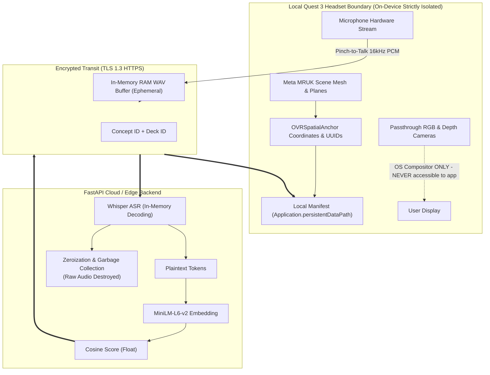

# RecallRoom XR — Privacy, Security & Data Governance Architecture

## 1. Core Privacy Philosophy

Mixed Reality headsets operate in intimate personal environments: bedrooms, home offices, classrooms, and clinical training rooms. They capture continuous sensor streams (cameras, microphones, spatial depth sensors, eye tracking, and hand poses).

**RecallRoom XR is engineered under a strict "Privacy-by-Design" architecture.** We maintain a zero-compromise perimeter:
* **Zero spatial geometry egress:** Physical room shapes, point clouds, and furniture boundaries never leave the local headset.
* **Transient voice transcription:** Spoken audio is never stored on disk or used for training; raw audio buffers are processed in volatile RAM and immediately wiped.
* **Zero student PII or biometric tracking:** No student facial geometry, iris scans, or biometric voiceprints are collected or derived.

---

## 2. Privacy Boundary Diagram



---

## 3. Data Classification & Perimeter Specification

| Data Type | Physical Source | Storage Location | Network Transmission | Retention Policy |
| :--- | :--- | :--- | :--- | :--- |
| **Passthrough Video** | Quest 3 Cameras | OS Compositor (Hardware) | **NEVER Transmitted** (OS Protected) | Not stored (Real-time frame buffer only) |
| **Room Mesh & Planes** | MRUK / Depth Sensor | Headset VRAM / RAM | **NEVER Transmitted** | Session-only / Local OS Room Model |
| **Spatial Anchor Coordinates** | `OVRSpatialAnchor` | Local Device Flash Storage | **NEVER Transmitted** | Persists locally on device until user resets |
| **Voice Audio (Student Utterance)** | Microphone (`RECORD_AUDIO`) | Volatile Client RAM $\to$ Backend RAM | Transmitted over TLS 1.3 HTTPS | **Immediately destroyed** upon transcription ($< 250\text{ ms}$) |
| **Transcribed Text** | Whisper Output | Backend RAM | Returned to client over HTTPS | Discarded after semantic evaluation |
| **Semantic Score & Priority** | MiniLM Output | Client Local JSON Manifest | Transmitted over HTTPS | Persisted on client device for study progress |

---

## 4. Transient Audio Lifecycle & In-Memory Destruction

To guarantee that no voice recordings persist or leak:

1. **Client-Side:**
   * The audio stream is captured using Unity's `Microphone.Start()` into an in-memory `AudioClip`.
   * When the user releases the pinch gesture, the recorded segment is converted to a 16-bit PCM WAV byte array in RAM.
   * As soon as the HTTP POST request completes, the client byte array is cleared and garbage-collected.

2. **Server-Side (`app/services/asr_service.py`):**
   * The incoming audio payload is read as an in-memory stream (`io.BytesIO`).
   * Whisper processes the raw floating-point samples directly in memory without writing temporary files to `/tmp` or disk.
   * Upon transcription completion, the `BytesIO` buffer is explicitly closed, overwritten, and deleted:
     ```python
     # Explicit In-Memory Destruction
     audio_stream.seek(0)
     audio_stream.truncate(0)
     del audio_stream
     ```

---

## 5. Regulatory Compliance Matrix

### 5.1 FERPA (Family Educational Rights and Privacy Act)
RecallRoom XR does not store student educational records or identifiable evaluation metrics on remote servers. All deck progress and performance history reside locally on the student's personal headset, ensuring educational record confidentiality.

### 5.2 COPPA (Children's Online Privacy Protection Act)
RecallRoom XR does not collect, use, or disclose personal information (including geolocation, real names, email addresses, or persistent identifiers) from children under the age of 13. Voice input is strictly functional, transient, and non-identifiable.

### 5.3 GDPR (General Data Protection Regulation)
* **Article 9 (Special Category Data):** Voice biometric data is NOT collected or processed. Voice is used purely for acoustic-to-phoneme transcription.
* **Article 25 (Data Protection by Design and by Default):** Minimal data collection principle is enforced.
* **Article 17 (Right to Erasure):** A single "Clear Data" button in the XR settings menu deletes all local spatial manifests, concept history, and anchor references immediately.

### 5.4 Meta Horizon Store Privacy Guidelines
* The application complies with all Meta XR Spatial Data policies.
* Declared permissions in `AndroidManifest.xml` are strictly bounded to features actively utilized by the user.

---

## 6. Permissions Audit & Justification

| Android Permission | Justification | User Prompt Experience |
| :--- | :--- | :--- |
| `android.permission.RECORD_AUDIO` | Required to record student answers during voice recall mode. | Standard system modal: "Allow RecallRoom XR to record audio?" |
| `com.oculus.permission.USE_ANCHOR_API` | Required to anchor knowledge cards to physical tables and walls. | System prompt: "Allow app to create spatial anchors in your space?" |
| `com.oculus.permission.USE_SCENE` | Required for MRUK to detect desk and table surfaces for snapping. | System prompt: "Allow app to access your room layout?" |
| `android.permission.INTERNET` | Required to send transient audio to the AI backend for scoring. | Granted automatically at install time. |
